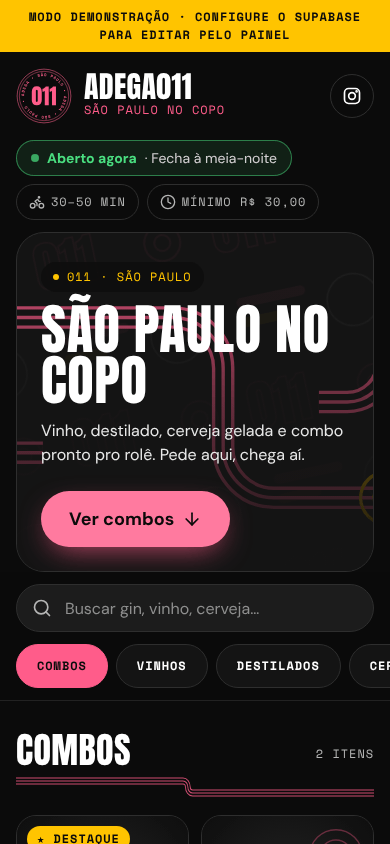
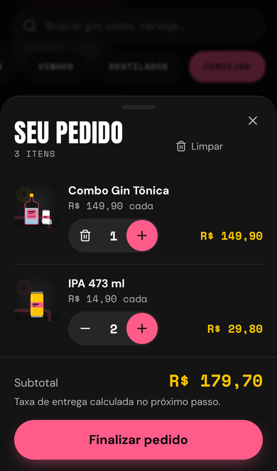
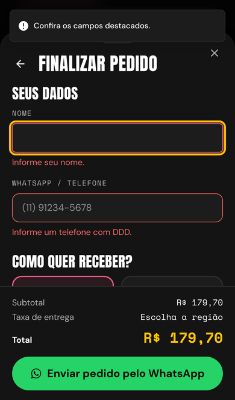
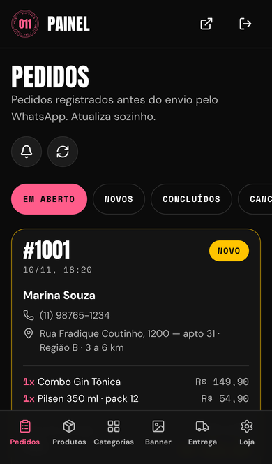

# Adega011 · São Paulo no copo

Loja virtual / cardápio digital da **Adega011**: o cliente monta o pedido pelo celular e envia pronto pelo **WhatsApp**. O dono gerencia tudo em um painel em `/admin`.

<p>
  
  
  
  
</p>

## O que tem

**Loja (cliente)**
- Banner editável. Quando não há imagem, usa o grafismo de linhas de rua da marca.
- Barra de categorias fixa, com rolagem horizontal, e busca que ignora acentos.
- Cards com foto grande (lazy loading), selos **Destaque**, **Esgotado** e **Últimas unidades**, e contador +/−.
- **Adicionais** no produto (como no iFood): ex.: Copão de Askov R$ 10,00 com Baly + R$ 3,00. Grupos com escolha obrigatória ou opcional e limite de opções.
- Carrinho em gaveta lateral (desktop) ou *bottom sheet* (celular), com botão flutuante mostrando quantidade e total.
- Checkout em uma tela: nome, telefone, entrega ou retirada, endereço, pagamento (Pix, cartão na entrega, dinheiro com troco) e observações.
- Taxa de entrega **por km rodado** (taxa inicial + valor por km, distância pela rua via Google Maps) ou **por região**, à escolha no painel.
- Validação de pedido mínimo e de campos obrigatórios. O pedido é registrado no banco e depois o `wa.me` abre com a mensagem formatada.
- Aviso de aberto/fechado pelo horário de São Paulo, inclusive para expediente que passa da meia-noite, com opção de abrir/fechar manualmente.
- Verificação de idade (+18), SEO (meta tags, Open Graph, sitemap, JSON-LD `LiquorStore`) e PWA instalável com página offline.

**Painel (`/admin`)**
- Login com e-mail e senha, só para o dono, com **“Esqueci minha senha”** (link por e-mail).
- **Pedidos** em tempo real, com aviso sonoro, status (novo → confirmado → saiu para entrega → concluído/cancelado), adicionais de cada item e atalho para o WhatsApp do cliente.
- **PDV** (venda no balcão): abrir caixa, vender tocando nos produtos (com adicionais), desconto em R$ ou %, troco calculado, cupom para impressora térmica de 80 mm, sangria/suprimento e fechamento com conferência da gaveta.
- **Estoque**: controle por produto, entrada de mercadoria, ajuste por contagem e histórico. Vendas do site e do balcão baixam sozinhas; cancelar devolve; no zero o produto aparece como esgotado.
- **Relatórios**: faturamento, pedidos, ticket médio, por dia, por forma de pagamento, site × balcão e mais vendidos.
- **Produtos**: criar, editar e excluir, adicionais, controle de estoque, foto por upload (reduzida para WebP no próprio celular) ou **colando o link de uma imagem** (o servidor baixa, reduz e guarda no Storage), destaque, esgotado, visível e ordem por arrastar. Fotos trocadas, descartadas ou de produtos excluídos são apagadas do Storage.
- **Categorias**: criar, renomear, ocultar e reordenar arrastando (mouse, toque ou teclado).
- **Banner**: título, texto, botão, link e imagem, com pré-visualização.
- **Entrega**: frete por km (taxa inicial, valor por km, raio máximo) ou por região, pedido mínimo, tempo de entrega e liga/desliga de entrega e retirada.
- **Loja**: nome, WhatsApp, endereço, Instagram, chave Pix, formas de pagamento, horários e abrir/fechar manual.

## Stack

| | |
|---|---|
| **Next.js 16** (App Router, Cache Components) + **TypeScript** | A vitrine é pré-renderizada e fica em cache. Quando você salva algo no painel, a loja é atualizada na hora. |
| **Tailwind CSS v4** + componentes no padrão **shadcn/ui** (Radix) | Acessíveis e com a identidade da marca |
| **Supabase** (Postgres, Auth, Storage, Realtime, Edge Functions) | Banco com RLS, login do admin, fotos, pedidos em tempo real e cálculo do frete |
| **Google Maps** (Geocoding + Routes) | Distância pela rua para o frete por km |
| **Zustand** | Carrinho salvo no navegador |
| **Playwright** + **axe-core** | Testes de ponta a ponta e de acessibilidade |

> **Modo demonstração:** sem as variáveis do Supabase, a loja abre com os dados de exemplo (produtos em 4 categorias, incluindo um com adicionais) e o checkout funciona normalmente. O painel exige o Supabase.

---

## 1. Rodar no seu computador

Pré-requisito: [Node.js](https://nodejs.org) 20.9 ou superior (recomendado 22).

```bash
npm install
```

```bash
npm run dev
```

Abra http://localhost:3000. Sem `.env.local`, a loja roda em modo demonstração.

## 2. Criar o projeto no Supabase

1. Crie uma conta em [supabase.com](https://supabase.com) e clique em **New project**. Escolha a região **South America (São Paulo)**.
2. No menu **SQL Editor**, rode **em ordem** cada arquivo de [`supabase/migrations/`](supabase/migrations) (cole o conteúdo inteiro e clique em **Run**):
   1. `20261110000000_schema.sql`: tabelas, regras de segurança (RLS), função de pedidos, bucket de fotos e Realtime;
   2. `20261111000100_adicionais_estoque.sql`: adicionais e estoque;
   3. `20261111000200_frete_pedidos_pdv.sql`: frete por km, pedido v2, PDV/caixa e relatórios.
   4. `20261111000300_permissoes_servico.sql`: permissões da função de frete (cotar-frete).

   Com a [CLI do Supabase](https://supabase.com/docs/guides/cli) dá para aplicar tudo com `npx supabase db push`.
3. Coloque os dados de exemplo usando **uma** destas opções:
   - no SQL Editor, rode [`supabase/seed.sql`](supabase/seed.sql); **ou**
   - configure o `.env.local` (passo 3) e rode `npm run seed`.
4. Em **Authentication → Sign In / Providers**:
   - deixe **Email** ativado;
   - **desligue “Allow new users to sign up”**, para que ninguém além de você consiga criar conta.

> Os dois scripts podem ser rodados de novo sem problema: o schema usa `if not exists` e o seed faz *upsert*.

## 3. Configurar as variáveis

Copie o arquivo de exemplo:

```bash
cp .env.example .env.local
```

Preencha com os dados de **Project Settings → API Keys** (ou do botão **Connect**):

| Variável | Onde achar | Vai para a Vercel/Netlify? |
|---|---|---|
| `NEXT_PUBLIC_SUPABASE_URL` | Project URL (`https://xxxx.supabase.co`) | Sim |
| `NEXT_PUBLIC_SUPABASE_ANON_KEY` | Chave **publishable** (`sb_publishable_…`) ou a legada **anon** | Sim |
| `SUPABASE_SERVICE_ROLE_KEY` | Chave **secret** (`sb_secret_…`) ou a legada **service_role** | **Não**: só para `npm run seed` e `npm run criar-admin` no seu computador |
| `NEXT_PUBLIC_SITE_URL` | O endereço do site (ex.: `https://adega011.com.br`) | Sim |

> O `.env.local` está no `.gitignore`. **Nunca** faça commit da chave secreta.

## 4. Criar o usuário admin

**Opção A: pelo terminal (recomendado)**

```bash
npm run criar-admin -- voce@adega011.com.br "UmaSenhaForte123"
```

**Opção B: pelo painel do Supabase**

1. Vá em **Authentication → Users → Add user → Create new user**, informe e-mail e senha e marque **Auto Confirm User**.
2. No **SQL Editor**, rode:

   ```sql
   insert into public.admins (user_id)
   select id from auth.users where email = 'voce@adega011.com.br';
   ```

Depois é só entrar em `/admin/login`. Se esquecer a senha, use **“Esqueci minha senha”** na tela de login: o link chega por e-mail e deve ser aberto no mesmo navegador em que foi pedido.

> O e-mail padrão do Supabase tem limite baixo de envios por hora. Para produção, configure um SMTP próprio em **Authentication → Emails → SMTP Settings** (ex.: Resend, Brevo, Amazon SES). Um usuário que faz login mas não está na tabela `admins` vê “Acesso negado” e não consegue ler nem alterar nada, porque o RLS bloqueia no banco.

## 5. Frete por km (Google Maps)

A taxa é **taxa inicial + valor por km rodado** (ex.: R$ 2,00 + R$ 1,50/km), com a distância pela rua da loja até o cliente. Quem calcula é a Edge Function [`cotar-frete`](supabase/functions/cotar-frete/index.ts), que roda no Supabase e grava a cotação no banco. O pedido só aceita a taxa de uma cotação gravada (válida por 45 min e para o mesmo endereço), então ninguém consegue mudar o frete pelo navegador.

1. **Chave do Google**: no [Google Cloud Console](https://console.cloud.google.com/), crie um projeto e ative as APIs **Geocoding API** e **Routes API**. Em **APIs e serviços → Credenciais**, crie uma **chave de API** e restrinja-a a essas duas APIs. O Google pede um cartão, mas tem cota gratuita mensal que uma adega dificilmente ultrapassa.
2. **Publicar a função** (uma vez):

   ```bash
   npx supabase functions deploy cotar-frete --no-verify-jwt
   ```

3. **Guardar a chave** em **Supabase → Edge Functions → Secrets** com o nome `GOOGLE_MAPS_API_KEY`. A chave fica só no Supabase, nunca no site.
4. No painel, em **Entrega → Como cobrar a entrega**, escolha **Por km rodado** e confira a taxa inicial, o valor por km, o raio máximo e a cidade padrão.

> O endereço da loja (em **Painel → Loja**) é o ponto de partida. Ele é localizado uma vez e guardado; se mudar, é localizado de novo automaticamente.

## 6. Deploy

### Vercel (recomendado)

1. Em [vercel.com/new](https://vercel.com/new), importe o repositório `adega011-loja`. O Framework Preset “Next.js” é detectado sozinho.
2. Em **Environment Variables**, adicione `NEXT_PUBLIC_SUPABASE_URL`, `NEXT_PUBLIC_SUPABASE_ANON_KEY` e `NEXT_PUBLIC_SITE_URL`.
3. Clique em **Deploy**. Para usar seu domínio, configure em **Settings → Domains**.
4. No Supabase, vá em **Authentication → URL Configuration**:
   - **Site URL**: o endereço do site (ex.: `https://adega011.com.br`);
   - **Redirect URLs**: adicione `https://adega011.com.br/admin/auth/confirmar` (e, para testar no computador, `http://localhost:3000/admin/auth/confirmar`). Sem isso, o link de “Esqueci minha senha” não funciona.

### Netlify

1. Em **Add new project → Import an existing project**, escolha o repositório. O `netlify.toml` já está configurado e o Netlify detecta Next.js automaticamente.
2. Em **Site configuration → Environment variables**, adicione as mesmas três variáveis e faça o deploy.

> Sempre que mudar uma variável `NEXT_PUBLIC_*`, faça um novo deploy: elas entram no código no momento do build.

## 7. Personalizar

- **Dados reais da loja** (WhatsApp, endereço, horário, pedido mínimo, regiões e taxas): edite pelo painel em `/admin/loja` e `/admin/entrega`. Os valores iniciais ficam em [`src/lib/dados-exemplo.ts`](src/lib/dados-exemplo.ts). Se mudar esse arquivo, rode `npm run seed:sql` para atualizar o `seed.sql`.
- **Logo**: o selo usado no site é `public/logo-selo.svg`; as variações do kit estão em `public/marca/`. Os ícones do app e o favicon ficam em `public/icons/`, `src/app/icon.svg` e `src/app/apple-icon.png`.
- **Cores e fontes**: em [`src/app/globals.css`](src/app/globals.css) (tokens `--color-*`).
- **Tema claro e escuro**: o botão de sol/lua no topo da loja e no menu do painel troca o tema, e a escolha fica salva no aparelho. O padrão é o escuro (preto é a base da marca). Nos componentes, use as cores de função (`bg-fundo`, `text-texto`, `bg-superficie`, `text-suave`, `text-rosa-texto`, `text-amarelo-texto`, `text-preco`), que mudam com o tema. As cores da marca (`bg-rosa`, `bg-amarelo`, `text-preto` em cima delas) ficam fixas. Seguindo o manual, o tema claro não usa rosa nem amarelo como cor de texto sobre o branco (contraste baixo): eles aparecem como preenchimento, e os textos usam tons mais fechados. Um bloco com a classe `tema-escuro` (como o banner) fica sempre escuro. Para logos, use `LogoTema` (selo rosa no escuro e preto no claro).
- **Fotos de exemplo**: são ilustrações em `public/produtos/`. Troque pelas fotos reais pelo painel.

## 8. Testes

```bash
npm run lint
```

```bash
npm run typecheck
```

Testes de ponta a ponta em modo demonstração (fluxo de compra, taxa, link do WhatsApp, loja fechada e acessibilidade):

```bash
npm run test:e2e
```

Testes de integração com um Supabase **local**. Precisa do Docker e usa `supabase init` + `supabase start`. Antes de rodar, aponte o `.env.local` para o Supabase local e crie o admin `dono@adega011.test` / `SenhaForte123`, ou passe `ADMIN_EMAIL`/`ADMIN_SENHA`:

```bash
npm run test:e2e:supabase
```

Para o frete, rode também `npx supabase functions serve --env-file supabase/functions/.env` com `MAPS_FAKE=1` nesse arquivo (o modo de teste inventa os km, sem gastar a cota do Google). Esses testes cobrem PDV com caixa, estoque, frete por km, relatórios, login, recuperação de senha (lendo o e-mail no Mailpit do `supabase start`), pedido em tempo real, edição, upload e limpeza de fotos, reordenação, taxa, banner, loja fechada e RLS. No `supabase/config.toml` local, use `site_url = "http://localhost:3200"` e `additional_redirect_urls = ["http://localhost:3200/**"]`. Eles alteram dados, então use um banco de testes e rode `npx supabase db reset` antes.

## Estrutura

```
src/
  app/
    page.tsx              vitrine
    admin/                login, recuperar/nova senha e painel (pedidos, produtos, categorias, banner, entrega, loja)
    admin/auth/confirmar  recebe o link do e-mail e cria a sessão
    admin/acoes.ts        Server Action que revalida a vitrine (confere se é admin)
    manifest.ts, robots.ts, sitemap.ts, opengraph-image.png
  components/
    loja/                 banner, catálogo, card, carrinho/checkout, idade, rodapé
    admin/                telas e componentes do painel
    marca/                grafismos (linhas de rua, padrão 011) e ícones
    ui/                   botões, campos e gaveta (padrão shadcn/ui)
  lib/
    loja.ts               carrega os dados da vitrine (com cache)
    pedido.ts             totais, validação e mensagem do WhatsApp
    horario.ts            aberto/fechado no fuso de São Paulo
    carrinho.ts           estado do carrinho
  proxy.ts                protege /admin (o antigo middleware)
supabase/
  migrations/             schema + RLS + função criar_pedido + storage
  seed.sql                dados de exemplo (gerado por npm run seed:sql)
scripts/                  seed, criar-admin, gerar seed.sql
tests/                    Playwright (demo e integração com Supabase)
```

## Segurança

- **RLS em todas as tabelas.** O visitante só **lê** o catálogo ativo e as configurações. Só quem está na tabela `admins` escreve.
- **Estoque**: o saldo só muda por pedido, venda no balcão ou ajuste no painel (com histórico); nem o admin consegue editar o número direto.
- **Frete**: cotações são gravadas pela Edge Function com a chave de serviço; o visitante não lê nem cria cotações.
- **PDV, caixa e relatórios**: funções que conferem se quem chama é admin.
- **Pedidos** não podem ser lidos nem inseridos diretamente pelo público. Eles passam pela função `criar_pedido()`, que **recalcula** preços, taxa, pedido mínimo e troco no servidor, recusa itens esgotados e limita a 5 pedidos por telefone a cada 10 minutos.
- **Fotos**: o bucket é público para leitura pela URL; só o admin lista, envia, troca ou apaga.
- **Recuperação de senha**: a rota de retorno só redireciona para dentro de `/admin` (sem redirecionamento aberto) e a tela não revela se um e-mail tem conta.
- A atualização da vitrine (`revalidarLoja`) confere a sessão e a permissão de admin no servidor.


## Kits, fardos e estoque em ml

Em **Produtos**, escolha produto simples ou kit. Um kit não recebe saldo próprio:
sua composição define quanto de cada produto base é consumido por venda.
O cadastro e a edição abrem em uma página própria. Ao escolher kit, selecione
os componentes em **Composição do kit** e salve uma única vez. Produto e
composição são gravados juntos; erros não deixam um cadastro incompleto.

- **Fardo Skol 15 un**: 15 unidades do produto simples Skol lata 269 ml.
- **Copão de Askov**: 100 ml do produto simples Askov 900 ml.
- **Askov 900 ml**: unidade de estoque `ml`, volume por garrafa `900`.
  Uma garrafa inteira vendida desconta 900 ml; cada copão desconta 100 ml.

Em **Estoque**, lance as latas no produto avulso. Para bebidas em ml, a entrada
pode ser feita em garrafas inteiras (conversão automática) ou diretamente em ml.
O ajuste de contagem é sempre na unidade base. Nove copões consomem 900 ml.
Os dois canais (site e PDV) dividem o saldo. Se faltar qualquer componente,
o banco recusa a venda inteira. O histórico registra cada baixa em un ou ml.
Cancelamento, reativação e exclusão usam o consumo gravado na venda original,
mesmo se a receita do kit mudar depois. Kits aninhados não são permitidos.
Unidades de produtos com histórico não podem ser trocadas, para não misturar
unidades com ml no histórico; nesses casos, cadastre um novo produto base.

As composições ficam restritas ao administrador. A vitrine recebe somente o
número de unidades/garrafas/kits que podem ser vendidos. A migration
`20261111031052_kits_estoque_ml.sql` precisa estar aplicada antes do frontend.

Verificação: `npm run test:unit`. O arquivo `tests/sql/kits_estoque.sql` pode ser
executado no SQL Editor: verifica os dois canais, baixa compartilhada,
cancelamento, reativação, falta de estoque e permissões. Os dados de teste
são revertidos com `ROLLBACK` (a numeração sequencial pode apresentar lacunas).


O formulário fica em `/admin/produtos/novo` e a edição em
`/admin/produtos/[id]`. Fotos descartadas ao sair são removidas do Storage.
O RPC `salvar_produto_com_kit` exige admin, aceita somente os campos do
cadastro e mantém o saldo de estoque protegido. O identificador do rascunho
é reutilizado em tentativas de salvar, evitando duplicação após falha de rede.
O teste `tests/sql/cadastro_produto_com_kit.sql` valida criação em uma etapa,
repetição de salvamento, reversão de cadastro com receita inválida e permissões.


## Variações de produtos

Em **Produtos → Novo produto**, escolha **Produto com variações**. Preencha o
nome base (ex.: Energético Baly), o tipo da variação (Sabor ou Tamanho) e cada
opção com seu preço. Exemplos: Melancia, Morango, Pêssego; ou 269 ml e 350 ml.
Uma opção também pode combinar atributos: Melancia / 2 L. Salve uma única vez.
Para incluir tamanhos em um produto simples existente, edite-o, mude o tipo e
use a primeira linha para a opção atual: seu identificador, saldo e vínculos
com kits são preservados. Kits existentes não podem virar variações.

Cada variação é um SKU real em `produtos`, com preço, saldo, disponibilidade e
visibilidade próprios. Faça entradas na tela Estoque selecionando a variação
exata. Para estoque em ml, configure o volume de cada garrafa. Kits usam o SKU
específico, por exemplo Skol · 269 ml; nunca o agrupamento. Adicionais também
continuam específicos de cada variação, acessíveis em seu cadastro salvo.
Opções existentes podem ser desativadas sem apagar seu histórico ou saldo.

O catálogo e o PDV agrupam os SKUs somente para exibição. Ao vender, selecionar
uma opção usa seu ID, preço e saldo próprios no carrinho, pedido e cupom.
A busca também encontra o nome das variações. O RPC `salvar_produto_variacoes`
exige admin, grava todo o grupo atomicamente e reutiliza IDs em novas tentativas.
Não há saldo nem produto pai vendável. O saldo não é aceito pelo cadastro.
`npm run test:unit` verifica agrupamento e seleção; `tests/sql/variacoes.sql`
valida gravação atômica, duplicação, preservação de kits/saldo, permissões e
consumo separado por SKU em uma transação revertida com `ROLLBACK`.


O cadastro usa abas Dados gerais, Variações ou Composição, Fotos e
Adicionais. Os campos de controle de estoque ficam em Dados gerais. Campos compactos no desktop e a grade em tabela tornam a tela mais
compacta. Em telas de toque os controles mantêm alvos de pelo menos 44 px.
Trocar de aba preserva o rascunho; a validação abre a seção com campos pendentes.
Os ajustes visuais ficam restritos ao formulário de produto.


## Entrada de estoque por pacotes

Em Produtos → Dados gerais → Controle de estoque, selecione UN e informe
Unidades por pacote (ex.: 50 folhas). O padrão 1 mantém as entradas avulsas.
Em Estoque → Entrada, escolha Pacotes de 50 UN e informe a quantidade de
pacotes: 10 × 50 = 500 UN. Unidades avulsas continuam disponíveis na mesma
entrada. A venda avulsa desconta 1 UN; a embalagem não altera preço, composição
ou saldo vendável. Variações podem ter quantidades por pacote diferentes.

Garrafas usam o volume em ml existente. Ajuste de contagem sempre usa a unidade
base. Alterar o tamanho do pacote afeta somente novas entradas; não reinterpreta
o saldo nem as movimentações anteriores. A entrada por embalagem registra a
conversão na observação do histórico.

O RPC registrar_entrada_estoque exige admin e converte no servidor sob a mesma
trava transacional de vendas e estoque. Confere o fator apresentado na tela,
recusando entradas se a embalagem tiver mudado em outro cadastro. Os RPCs de
cadastro gravam unidades_pacote sem aceitar alterações diretas de saldo.
O teste tests/sql/entrada_por_pacotes.sql verifica conversão, venda avulsa,
kits, garrafas, contagem, histórico, limites, fatores por variação e permissões,
revertendo os dados com ROLLBACK.


## Venda por pacote completo ou volume

Em Dados gerais → Unidade de venda, escolha UN (avulsa) ou PCT (pacote completo).
Em PCT, uma venda consome o número cadastrado em Unidades por pacote; em UN,
uma venda consome 1. O preço corresponde a uma venda da opção escolhida.
O estoque permanece em unidades base, sem recontagem ao mudar a configuração.
Para líquidos, Volume por venda (ml) define o consumo: 1 litro = 1.000 ml.

O campo vende_pacote controla a venda de produtos com estoque UN. O gatilho
calcula volume_unidade como fator de consumo por venda (50 UN no pacote de 50,
1 UN no avulso). Para líquidos, mantém o volume em ml. Os cálculos existentes de
saldo vendável e baixa usam esse fator no site e no PDV. Componentes de kits
continuam expressos em quantidades base, então uma seda solta composta por
1 UN do produto-pacote continua baixando uma única folha do estoque compartilhado.
Cancelamentos usam o consumo original da venda, mesmo após alteração do pacote.

Apenas configurar unidades_pacote não muda a venda: também selecione PCT para
produtos vendidos como pacote completo. Teste SQL: tests/sql/venda_por_embalagem.sql
(valida os dois canais, preço, falta de estoque conjunta, cancelamento e litros).


## PDV: itens e pagamento em etapas

A tela principal prioriza busca e lista de itens, com total e Ir para pagamento
no rodapé. O filtro de categorias fica no botão ao lado da busca; a seleção
continua aplicada ao recolher o filtro. As linhas de produto mostram detalhes
quando relevantes (variação, adicionais, estoque baixo ou quantidade na venda).
Pagamento, recebido, troco, desconto e cliente aparecem somente ao avançar.
Voltar aos itens preserva os dados do pagamento; Limpar venda os descarta.
A conclusão continua no RPC existente, gerando cupom e iniciando uma nova venda.
Referências de fluxo: Olist e GestãoClick (pagamento após montagem da venda).
