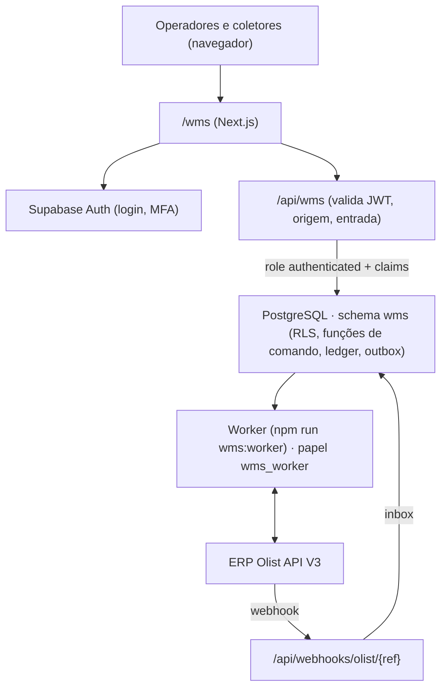

# WMS · Instalação, configuração e integração Olist

## 1. Como as peças se ligam



- **Fonte da verdade operacional**: o ledger `wms.stock_entries` (imutável) e a projeção `wms.stock_balances`, atualizados na mesma transação.
- **Olist** mantém o comercial, o fiscal e o saldo agregado por depósito. O WMS não reconstrói lógica fiscal.
- O estoque da loja (`public.produtos.estoque`) é independente do WMS. Não ligue os dois sem uma política única de lançamento.

## 2. Instalação local

```bash
npm install
```

Banco de teste local (PostgreSQL 16 com `psql`, `createdb`, `dropdb`). O script recria o banco informado e aplica o *shim* do Supabase só para testes:

```bash
PGHOST=localhost PGUSER=postgres WMS_TEST_DB=wms_test npm run wms:db:local
```

```bash
WMS_TEST_DATABASE_URL=postgresql://postgres@localhost:5432/wms_test npm run test:wms
```

```bash
WMS_TEST_DATABASE_URL=postgresql://postgres@localhost:5432/wms_test npm run test:e2e:wms
```

O e2e do WMS sobe um **Auth falso** (`tests/e2e-wms/auth-falso.ts`) e o `next dev`. Nunca use esse servidor fora de testes.

## 3. Supabase (homologação e produção, projetos separados)

1. Aplique as migrations `supabase/migrations/*_wms_*.sql` em ordem (`npx supabase db push` ou SQL Editor). Elas criam o schema `wms`, o papel `wms_worker`, as políticas RLS e o bucket privado `wms-evidencias` (10 MB, imagens e PDF).
2. **Não** exponha o schema `wms` no PostgREST (API Settings → Exposed schemas). O acesso é só pelo backend.
3. Authentication: desligue o cadastro público ("Allow new users to sign up") e habilite **MFA TOTP**. Configure SMTP próprio para os convites.
4. Crie o primeiro administrador: convide o e-mail pelo painel do Supabase, peça para a pessoa definir a senha e rode:

   ```bash
   DATABASE_URL=postgresql://... npm run wms:bootstrap -- admin@empresa.com.br EMPRESA "Nome da Empresa" "Nome do Admin"
   ```

   No primeiro acesso, cadastre o autenticador em `/wms/conta`. Sem MFA, as telas de administração e aprovação de ajuste recusam as operações (exigência no servidor).
5. Em **Administração**: crie armazéns (já vêm com `RECEB`, `STAGE`, `QUAR`, `DEVOL`, `TRANSITO`, `DOCA-1`), zonas, endereços (marque "Separação" nos endereços de picking), produtos manuais e unidades com fator (ex.: `CX12` = 12). Convide os usuários com perfil e armazém.

### Conexão do backend com o banco

O backend e o worker usam `DATABASE_URL` (string de conexão do Postgres do projeto; prefira o pooler em modo transação). Cada requisição abre uma transação e faz `set_config('role','authenticated')` com os claims do JWT verificado, como o PostgREST. O worker usa `set_config('role','wms_worker')`. O usuário da conexão precisa poder assumir esses papéis (`authenticated` já é concedido ao `postgres` no Supabase; a migration concede `wms_worker` a quem a aplicou). Valide isso no projeto real antes do go-live.

## 4. Variáveis de ambiente

Veja `.env.example`. Resumo do WMS:

| Variável | Onde | Para quê |
|---|---|---|
| `NEXT_PUBLIC_SUPABASE_URL`, `NEXT_PUBLIC_SUPABASE_ANON_KEY` (ou `..._PUBLISHABLE_KEY`) | site | Login no navegador |
| `SUPABASE_SECRET_KEY` | **só servidor** | Convite de usuários |
| `DATABASE_URL` | site + worker | Conexão transacional |
| `APP_URL` | site | Origem permitida (CSRF) e links de convite |
| `OLIST_CLIENT_ID`, `OLIST_CLIENT_SECRET`, `OLIST_REDIRECT_URI` | site + worker | OAuth |
| `OLIST_API_BASE_URL` | worker | Padrão: `https://api.tiny.com.br/public-api/v3` |
| `OLIST_WRITE_ENABLED` | worker | `false` por padrão. Escrita real exige isto **e** "escrita habilitada" na conexão |
| `INTEGRATION_ENCRYPTION_KEY` (+ `_VERSION`, `_PREVIOUS`) | site + worker | Chave AES-256 (32 bytes em base64) dos tokens. Fica fora do banco |
| `OLIST_RATE_READ_PER_MIN`, `OLIST_RATE_WRITE_PER_MIN` | worker | Limite inicial por conta (ajustado pelos cabeçalhos reais) |

Gerar chave de cifragem:

```bash
node -e "console.log(require('crypto').randomBytes(32).toString('base64'))"
```

Rotação: defina a nova chave com versão maior e mova a antiga para `INTEGRATION_ENCRYPTION_KEY_PREVIOUS=1:<base64>`. Os tokens são regravados com a chave nova a cada renovação.

## 5. Conectar a Olist

1. No ERP: crie um **aplicativo privado** (uso próprio não exige homologação de parceiro), marque só as permissões necessárias e cadastre a URL de redirecionamento `https://SEU-WMS/api/integrations/olist/callback`.
2. Em **Integrações → Nova conexão**, escolha "Olist API V3" e clique em **Autorizar na Olist** (precisa estar logado como administrador com MFA). O mesmo administrador precisa concluir o login no ERP; o `state` vale 10 minutos e é de uso único.
3. **Importar depósitos** e mapear cada depósito ao armazém correspondente. Sem mapeamento, pedidos daquele depósito ficam com falha visível na inbox.
4. **Importar produtos** (pelo ID do ERP). Configure lote/validade/série e unidades no WMS (o ERP não define isso aqui).
5. Defina as **situações elegíveis** do pedido (ex.: `3` Aprovada, `4` Preparando envio) e as que significam cancelamento (padrão `2`). É decisão de negócio.
6. Webhooks (se o plano tiver o app "Webhooks"): uma URL por tipo, usando o identificador mostrado ao criar a conexão:
   - `https://SEU-WMS/api/webhooks/olist/{ref}?tipo=vendas`
   - `...?tipo=enviados`, `...?tipo=estoque`, `...?tipo=notas`

   O aviso só entra na fila; o worker consulta o pedido/estoque na API autenticada. Sem webhook, use **Buscar pedidos** (ou agende) para a sincronização incremental.
7. Rode o worker: `npm run wms:worker` (laço) ou `npm run wms:worker -- --once` num agendador.

## 6. Política de lançamento de estoque (obrigatória antes de escrever no ERP)

Para cada depósito mapeado, em **Integrações → Depósitos → Política**:

| Saída | Quando usar |
|---|---|
| `erp_on_invoice` | O ERP já baixa ao faturar/lançar o pedido. O WMS **só reconhece** o despacho; nenhum lançamento é enviado |
| `wms_on_dispatch` | O ERP **não** baixa sozinho e o WMS solicita a baixa ao despachar (`POST /estoque/{idProduto}`, tipo `S`). Hoje fica bloqueado até definir a origem do `precoUnitario` exigido pelo contrato |

| Entrada | Quando usar |
|---|---|
| `erp_on_document` | A nota de entrada/ordem de compra já lança estoque no ERP |
| `wms_on_receipt` | O WMS lança a entrada ao confirmar o recebimento |

- Marque como **validada** só depois de testar em ambiente apropriado e registre como foi validado (fica na auditoria).
- Política não validada: o fato fica registrado como `blocked` (visível) e nada é enviado. Quando a política for definida, use **Reprocessar** (se passou a ser lançamento pelo WMS) ou **Cancelar** (se o ERP já lança).
- Movimentação entre endereços do mesmo armazém nunca gera lançamento. Transferência entre depósitos e saídas de qualidade (descarte, devolução ao fornecedor) e ajustes de inventário ficam `blocked` até haver fluxo validado.
- Liberação fiscal: com "Exigir liberação fiscal" no armazém (padrão), o despacho exige nota autorizada. Configure em `settings.fiscal_authorized_statuses` da conexão os valores de `notaFiscal.situacao` que a empresa considera autorizada.

## 7. Hospedagem

O site atual roda no Netlify/Vercel/Render. O WMS precisa, além do site, de um **processo contínuo** para o worker (Render Background Worker, um contêiner, ou um agendador chamando `npm run wms:worker -- --once` a cada minuto) e da `DATABASE_URL` no ambiente do site (as rotas `/api/wms` usam conexão Postgres direta). Escolha a hospedagem antes do piloto; o código não presume nenhuma.
